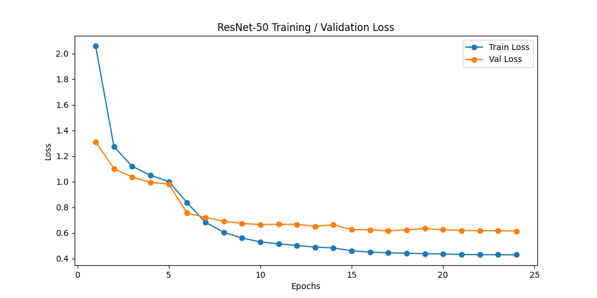

# Türk Yemekleri Kalori Tahmini / Turkish Food Calorie Estimation

**[Türkçe](#türkçe) · [English](#english)**

---

## Türkçe

### Proje nedir?

Bir tabak yemeğin tek fotoğrafından, o yemeğin **ne olduğunu** ve **kaç kalori** içerdiğini tahmin eden bir bilgisayarlı görü projesi.

Buradaki asıl zorluk şu: bir fotoğraf tek başına ölçü bilgisi taşımaz. Aynı pizza fotoğrafı yakından da uzaktan da çekilebilir, piksel sayısı değişir ama yemek aynı kalır. Bu yüzden proje, fotoğrafın içine konulan **1 TL madeni parasını cetvel olarak** kullanır. Paranın gerçek çapı 26.15 mm olduğu bilindiğinden, fotoğraftaki her pikselin gerçek hayatta kaç milimetreye karşılık geldiği hesaplanabilir.

Ölçek bir kez bulunduktan sonra sistem yemeği arka plandan ayırır, hangi yemek olduğunu sınıflandırır, derinlik tahminiyle yüksekliğini çıkarır ve hacmini cm³ olarak hesaplar. Son adımda bu hacim, yemek türüne özel cm³ başına kalori değeriyle çarpılarak toplam kalori bulunur.



### Nasıl çalışıyor?

Analiz dört modelin sırayla çalışmasıyla yapılır:

1. **Ölçek referansı (YOLO)** — Fotoğraftaki 1 TL parası tespit edilir. Paranın gerçek çapı 26.15 mm, kutu genişliğine bölünerek `piksel → mm` dönüşüm katsayısı (`px_to_mm`) bulunur.
2. **Segmentasyon (SAM 2)** — Yemek, tabaktan ve masadan ayrılarak maskesi çıkarılır.
3. **Sınıflandırma (ResNet-50)** — Maskelenen bölge kırpılıp 46 sınıflık Türk yemekleri modeline verilir.
4. **Derinlik ve hacim (Depth Anything V2)** — Derinlik haritası çıkarılır, paranın merkezi zemin (masa) seviyesi kabul edilir. Maske içindeki her pikselin zeminden yüksekliği hesaplanır, piksel taban alanıyla çarpılıp toplanır. Bu bir **Riemann toplamıdır**: yemek, her biri bir piksel tabanlı ince dikdörtgen prizmalara bölünür ve hacimleri toplanır.

### `150.0` sabiti neden var?

Kodun en kritik ve en çok soru işareti doğuran satırı bu:

```python
height_mm = np.abs(depth_n[mask] - ground_level) * 150.0
```

Sebebi şu: **1 TL parası bize yalnızca yatay ölçeği verir, dikey ölçeği vermez.**

Para düz bir disktir; fotoğrafta genişliği görünür ama kayda değer bir yüksekliği yoktur. Dolayısıyla `px_to_mm` katsayısı X ve Y eksenlerinde (yani taban alanında) mm cinsinden gerçek ölçü sağlar, ancak Z ekseninde (yükseklikte) hiçbir bilgi vermez.

Öte yandan Depth Anything V2 **monoküler** bir derinlik modelidir ve **göreli** derinlik üretir — çıktısı metre veya milimetre değil, birimsiz bir sayıdır. Üstelik bu sayıların aralığı fotoğraftan fotoğrafa değişir; bir görüntüde -200 ile 500 arasındayken diğerinde 1000 ile 8000 arasında olabilir. Kod bu yüzden min-max normalizasyonu uygular:

```python
depth_n = (depth - depth.min()) / (depth.max() - depth.min())
```

Bu işlem tüm görüntüleri ortak bir 0–1 skalasına oturtur: `0` sahnedeki en uzak nokta, `1` en yakın noktadır. Ama sonuç hâlâ birimsizdir — elimizde "yemek zeminden 0.2 birim yukarıda" gibi bir bilgi vardır, bunun kaç milimetre olduğu bilinmez.

`150.0` işte bu boşluğu doldurur. Anlamı şudur: **bu çekim düzeninde sahnenin en yakın ve en uzak noktası arasındaki mesafe yaklaşık 150 mm'dir.** Yani normalize skaladaki 1.0'lık tam fark 150 mm'ye, 0.2'lik fark ise 30 mm'ye karşılık gelir. Değer teorik bir formülden türetilmemiştir; masaüstü çekim mesafesinde gerçek ölçümlerle karşılaştırılarak deneme yanılmayla bulunmuş **ampirik bir kalibrasyon katsayısıdır**.

Bunun pratikteki sonucu önemli: sabit yalnızca kalibre edildiği çekim koşulunda geçerlidir. Kamerayı yemeğe belirgin şekilde yaklaştırır, uzaklaştırır veya açıyı değiştirirsen sahnenin gerçek derinlik aralığı da değişir ve `150.0` yanlış sonuç üretmeye başlar. Yeniden kalibre etmek için yüksekliği cetvelle ölçülmüş bir cisim (örneğin bir bardak) fotoğraflanır ve şu oran hesaplanır:

```
yeni sabit = cismin gerçek yüksekliği (mm) / (cismin tepesinin normalize derinliği - zeminin normalize derinliği)
```

### Dosyalar

| Dosya | Açıklama |
|---|---|
| `egitim.py` | ResNet-50 sınıflandırıcısının eğitim betiği (transfer learning, 50 epoch) |
| `tahmin_final.py` | Tam analiz hattı: tespit → segmentasyon → sınıflandırma → hacim → kalori |
| `turk_yemekleri_labels.py` | Eğitim sırasında otomatik üretilen 46 sınıflık etiket listesi |
| `sunucu.py` | Flutter istemcisinin bağlanacağı Flask API (`POST /analiz`) — henüz sahte sonuç döndürüyor |
| `sam2_hiera_l.yaml` | SAM 2 model mimarisi yapılandırması |
| `best.pt` | 1 TL tespiti için eğitilmiş YOLO ağırlığı |
| `test fotoğrafları/` | Referans paralı ve parasız örnek test görselleri |

### Kurulum

```bash
python -m venv .venv
source .venv/bin/activate
pip install -r requirements.txt
```

Depth Anything V2 ve SAM 2 pip paketi olarak değil, kaynak repolarından kullanılıyor:

```bash
git clone https://github.com/DepthAnything/Depth-Anything-V2
git clone https://github.com/facebookresearch/sam2 segment-anything-2
```

`tahmin_final.py` içindeki `sys.path.append(...)` satırlarını kendi klasör yollarınıza göre güncelleyin.

### Model ağırlıkları

Boyutları GitHub sınırlarını aştığı için depoya dahil **edilmedi**. Proje kök dizinine indirin:

| Dosya | Boyut | Kaynak |
|---|---|---|
| `sam2_hiera_large.pt` | 857 MB | [SAM 2](https://github.com/facebookresearch/sam2#model-description) |
| `depth_anything_v2_vitl.pth` | 1.3 GB | [Depth Anything V2 (Large)](https://huggingface.co/depth-anything/Depth-Anything-V2-Large) |
| `turk_yemekleri_resnet50.pth` | 90 MB | `egitim.py` ile kendiniz eğitin |

### Veri seti

Eğitim verisi (`Turkish Food/`, 46 sınıf, ~21.600 görsel, 675 MB) depoya dahil edilmedi. Kendi verinizle eğitmek için görselleri sınıf adını taşıyan alt klasörlere yerleştirin:

```
Turkish Food/
├── adana-kebap/
├── baklava/
├── doner/
└── ...
```

### Kullanım

```bash
python egitim.py          # modeli eğit
python tahmin_final.py    # tek görsel analizi (varsayılan: deneme.jpg)
```

Analiz çıktıları `cikti_1_yolo.jpg`, `cikti_2_seg.jpg` ve `cikti_3_depth.jpg` olarak kaydedilir.

### Doğruluk üzerine not

Hacim hesabı tek kameralı derinlik tahminine dayandığı için mutlak değil, göreli bir ölçümdür. Ayrıca yalnızca yemeğin görünen üst yüzeyi ölçülebildiğinden, tabağın içine gömülü hacim (örneğin çorbanın kâse içindeki derinliği) hesaba katılamaz.

---

## English

### What is this?

A computer vision project that estimates **what a dish is** and **how many calories it contains** from a single photograph.

The core problem is that a photograph carries no inherent sense of size. The same pizza can be shot from near or far — the pixel count changes while the food stays the same. This project solves that by placing a **1 Turkish Lira coin in the frame as a ruler**. Since the coin's real diameter is known to be 26.15 mm, the system can work out how many millimeters each pixel represents in the real world.

Once the scale is established, the system separates the food from its background, classifies which dish it is, recovers its height through depth estimation, and computes its volume in cm³. Finally, that volume is multiplied by a per-cm³ calorie density specific to the dish to produce the total calorie estimate.

### How it works

The analysis runs four models in sequence:

1. **Scale reference (YOLO)** — Detects the 1 TL coin. Dividing its real diameter of 26.15 mm by the bounding box width yields the `pixel → mm` conversion factor (`px_to_mm`).
2. **Segmentation (SAM 2)** — Isolates the food from the plate and table, producing a binary mask.
3. **Classification (ResNet-50)** — The masked region is cropped and fed to a 46-class Turkish food classifier.
4. **Depth and volume (Depth Anything V2)** — A depth map is produced and the coin's center is taken as ground (table) level. The height above ground of every pixel inside the mask is multiplied by the pixel's real-world base area and summed. This is a **Riemann sum**: the dish is decomposed into thin rectangular prisms, one per pixel, whose volumes are added up.

### Why the `150.0` constant?

This is the most critical and least self-explanatory line in the code:

```python
height_mm = np.abs(depth_n[mask] - ground_level) * 150.0
```

The reason it exists: **the coin gives us horizontal scale only, never vertical scale.**

A coin is a flat disc. Its width is visible in the photo, but it has no meaningful height. So `px_to_mm` provides real millimeter measurements along the X and Y axes (the base area), while telling us nothing about the Z axis (height).

Meanwhile, Depth Anything V2 is a **monocular** depth model that produces **relative** depth — its output is a unitless number, not meters or millimeters. Worse, the range of those numbers shifts from photo to photo: it might span -200 to 500 in one image and 1000 to 8000 in another. The code therefore applies min-max normalization:

```python
depth_n = (depth - depth.min()) / (depth.max() - depth.min())
```

This maps every image onto a common 0–1 scale, where `0` is the farthest point in the scene and `1` the nearest. But the result is still unitless — we know the food sits "0.2 units above the ground," without knowing how many millimeters that is.

`150.0` bridges exactly that gap. It encodes the assumption that **in this shooting setup, the distance between the nearest and farthest points of the scene is roughly 150 mm.** So a full difference of 1.0 on the normalized scale corresponds to 150 mm, and a difference of 0.2 corresponds to 30 mm. The value is not derived from any theoretical formula; it is an **empirical calibration factor**, found by trial and error at typical tabletop shooting distance and checked against real measurements.

The practical consequence matters: the constant only holds for the shooting conditions it was calibrated for. Move the camera noticeably closer or farther, or change the angle, and the scene's true depth range changes with it — at which point `150.0` starts producing wrong results. To recalibrate, photograph an object whose height you have measured with a ruler (a glass, for instance) and compute:

```
new constant = object's real height (mm) / (normalized depth at its top - normalized depth at the ground)
```

### Files

| File | Description |
|---|---|
| `egitim.py` | Training script for the ResNet-50 classifier (transfer learning, 50 epochs) |
| `tahmin_final.py` | Full pipeline: detection → segmentation → classification → volume → calories |
| `turk_yemekleri_labels.py` | Auto-generated list of the 46 class labels |
| `sunucu.py` | Flask API (`POST /analiz`) for the Flutter client — currently returns a dummy result |
| `sam2_hiera_l.yaml` | SAM 2 model architecture config |
| `best.pt` | YOLO weights trained to detect the 1 TL coin |
| `test fotoğrafları/` | Sample test images, with and without the reference coin |

### Setup

```bash
python -m venv .venv
source .venv/bin/activate
pip install -r requirements.txt
```

Depth Anything V2 and SAM 2 are used from source rather than as pip packages:

```bash
git clone https://github.com/DepthAnything/Depth-Anything-V2
git clone https://github.com/facebookresearch/sam2 segment-anything-2
```

Update the `sys.path.append(...)` lines in `tahmin_final.py` to match your own paths.

### Model weights

Excluded from the repository because of their size. Download them into the project root:

| File | Size | Source |
|---|---|---|
| `sam2_hiera_large.pt` | 857 MB | [SAM 2](https://github.com/facebookresearch/sam2#model-description) |
| `depth_anything_v2_vitl.pth` | 1.3 GB | [Depth Anything V2 (Large)](https://huggingface.co/depth-anything/Depth-Anything-V2-Large) |
| `turk_yemekleri_resnet50.pth` | 90 MB | Train it yourself with `egitim.py` |

### Dataset

The training data (`Turkish Food/`, 46 classes, ~21,600 images, 675 MB) is not included. To train on your own data, organize images into subfolders named after each class:

```
Turkish Food/
├── adana-kebap/
├── baklava/
├── doner/
└── ...
```

### Usage

```bash
python egitim.py          # train the model
python tahmin_final.py    # analyze a single image (default: deneme.jpg)
```

Outputs are written as `cikti_1_yolo.jpg`, `cikti_2_seg.jpg` and `cikti_3_depth.jpg`.

### A note on accuracy

Because the volume estimate relies on single-camera depth prediction, it is a relative rather than an absolute measurement. Only the visible top surface of the food can be measured, so volume hidden inside the dish — the depth of soup within a bowl, for example — is not accounted for.
